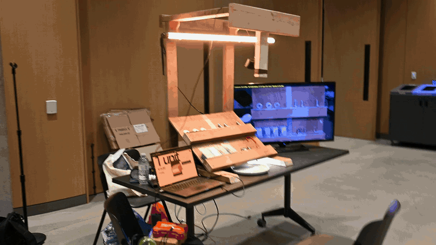
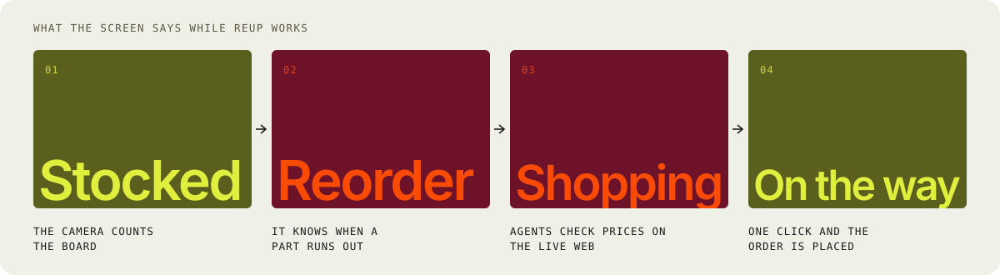

<a href="https://mllr.ca/media/reup-demo.mp4"></a>

# reup

Winning Best Domain at HackWestern13, an inventory management tracking system with YOLOE, OpenCV, QNX on a Raspberry Pi.



## Run it

```
npm install
npm run stack
```

Then open http://localhost:3000. Nothing leaves your laptop, the store and the shopper are stand ins. You need Node 22 or newer.

[wheredidallmyinventorygo.wtf](https://wheredidallmyinventorygo.wtf) · [the full demo](https://mllr.ca/media/reup-demo.mp4) · [how it fits together](docs/ARCHITECTURE.md) · [deploying it](docs/DEPLOY.md)
